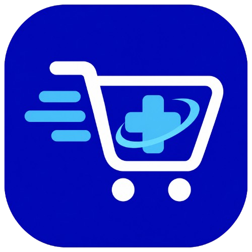

<p align="center">
  
</p>

<h1 align="center">SaúdePlus</h1>

<p align="center">
  <strong>Da necessidade à compra, em uma única conversa — com segurança e transparência.</strong>
</p>

<p align="center">
  
  
  
  
</p>

> ⚠️ **Repositório privado e confidencial.** Este material é de uso exclusivo do Squad 6 no HackaBusiness 2026. Veja a seção [Confidencialidade](#-confidencialidade-e-propriedade-intelectual) antes de compartilhar qualquer coisa.

---

## 📑 Sumário

1. [Visão geral](#-visão-geral)
2. [O problema](#-o-problema)
3. [Proposta de valor e diferenciais](#-proposta-de-valor-e-diferenciais)
4. [Escopo do MVP](#-escopo-do-mvp)
5. [Jornada do usuário](#-jornada-do-usuário)
6. [Segurança, saúde e conformidade](#-segurança-saúde-e-conformidade)
7. [Arquitetura proposta](#-arquitetura-proposta)
8. [Dados](#-dados)
9. [Product Backlog](#-product-backlog)
10. [Product Goal e métricas](#-product-goal-e-métricas)
11. [Time e acordo de trabalho](#-time-e-acordo-de-trabalho)
12. [Processo e cronograma](#-processo-e-cronograma)
13. [Definition of Done](#-definition-of-done)
14. [Estrutura do repositório](#-estrutura-do-repositório)
15. [Como executar](#-como-executar)
16. [Convenções de Git](#-convenções-de-git)
17. [Registro de decisões](#-registro-de-decisões)
18. [Riscos e pontos em aberto](#-riscos-e-pontos-em-aberto)
19. [Confidencialidade e propriedade intelectual](#-confidencialidade-e-propriedade-intelectual)
20. [Aviso importante](#-aviso-importante)

---

## 🎯 Visão geral

**SaúdePlus** é uma camada de inteligência artificial que fica entre a **intenção do cliente** e o **checkout** de um e-commerce de varejo farmacêutico. O cliente descreve, em linguagem natural, o que precisa resolver (por exemplo, *"pele seca que descasca no frio"*), e a SaúdePlus:

1. **entende** a necessidade e pergunta apenas o que falta;
2. **recomenda** de 3 a 5 produtos reais do catálogo, explicando o porquê de cada um;
3. **protege** o cliente, aplicando salvaguardas de saúde antes de qualquer sugestão;
4. **conduz** a compra até o carrinho e o checkout simulado, sem sair da experiência.

### Visão do produto

> Transformar o e-commerce em um ecossistema de **descoberta guiada e inteligente**, onde qualquer cliente encontra produtos de cuidados pessoais e bem-estar de forma imediata e personalizada a partir de suas necessidades reais, com a **confiança, clareza e segurança** que encontraria com um consultor especialista na loja física.

### Por que não é "mais um chatbot"

A conversa é a **porta de entrada**, não o produto. Um chatbot responde perguntas; a SaúdePlus **conduz uma jornada de compra**.

| Chatbot / atendimento (SAC) | SaúdePlus |
| --- | --- |
| Responde dúvidas e devolve links | Descobre a necessidade e entrega uma seleção pronta para comprar |
| Resposta em balões de texto | **Vitrine em tela**: cards com foto, preço, nota e justificativa |
| A compra acontece fora da conversa | Carrinho e checkout dentro do mesmo fluxo |
| Tenta ampliar o carrinho | **Compra consciente**: diz o que o cliente *não* precisa comprar |
| Trata todos igualmente | Personaliza pelo contexto da própria conversa |
| Responde qualquer coisa | Limites claros e auditáveis em saúde |

---

## 🧩 O problema

Resumo das dores que a SaúdePlus endereça:

- **Paralisia da escolha.** O catálogo tem dezenas de marcas de protetores, hidratantes e séruns, e o cliente conhece a *dor* ("pele seca"), mas não o *ingrediente* (ceramidas, niacinamida, ácido hialurônico).
- **Filtros rígidos.** A busca tradicional exige saber marca ou nome exato; filtros de marca, preço e linha não respondem a uma dúvida de **contexto de uso**.
- **Insegurança na indicação.** O cliente teme gastar R$ 100 ou mais em um produto que não sirva ao seu tipo de pele, e sente falta do consultor da loja física.

---

## 💡 Proposta de valor e diferenciais

1. **Vitrine em tela, não balões de texto.** A necessidade vira 3 a 5 produtos com comparativo e **kit completo em um clique**. É o argumento mais forte contra "mais um chatbot".
2. **Compra consciente e custo-benefício.** A SaúdePlus considera o **orçamento** informado pelo cliente, sugere equivalentes mais baratos quando atendem à mesma necessidade, evita itens redundantes e explica o que ficou de fora e por quê. *(Direcionamento da mentoria: recomendar com base em custo-benefício.)*
3. **Segurança como diferencial.** Em vez de sugerir medicamentos, a SaúdePlus **orienta a buscar um profissional** e organiza o contexto da conversa para a passagem ao farmacêutico.
4. **Transparência ("por que indicamos").** Cada recomendação mostra a justificativa e, quando houver, o caminho que levou até ela.
5. **Personalização pela conversa.** "Pele seca", "inverno" ou "para meu filho" já bastam. Nenhum dado de saúde é usado sem consentimento.
6. **Retirada na loja mais próxima.** Aproveita a rede física e já faz parte do checkout simulado.

### Benchmarking

| Referência | O que faz | Lacuna que a SaúdePlus explora |
| --- | --- | --- |
| Assistente de vendas por WhatsApp (Suri) | Catálogo, carrinho, entrega e Pix em conversa | Foco em atendimento e venda por texto; sem vitrine comparativa nem compra consciente |
| Assistente de saúde de rede farmacêutica | Ajuda a entender sintomas e reduzir automedicação | Não liga a necessidade à recomendação responsável e à compra |
| Assistentes de outras redes | Variam; alguns evitam sugerir medicamentos | Nenhum conecta **necessidade → recomendação responsável → compra** |

> A pesquisa de originalidade deve ser revisitada antes do pitch. Os dados acima vêm do levantamento da Sprint 0.

---

## 🧭 Escopo do MVP

### Dentro do escopo

- Entrada em **texto livre** (até 500 caracteres) com interpretação de intenção
- Pergunta de clarificação quando a intenção for ambígua
- Recomendação de **higiene, beleza, dermocosméticos e bem-estar**
- Justificativa por produto e kit completo
- **Salvaguardas de saúde** e encaminhamento ao farmacêutico/médico
- Carrinho e **checkout simulado** (frete por CEP ou retirada, Pix e cartão simulados, confirmação com código de rastreio simulado)
- Camada de **segurança de IA** (prompt injection, itens proibidos)

### Fora do escopo

- Atendimento/SAC (status de pedido, suporte geral)
- **Diagnóstico** e **prescrição** de qualquer tipo
- **Recomendação de medicamentos**, inclusive isentos de prescrição *(ver [decisão D-03](#-registro-de-decisões))*
- Venda de medicamentos tarjados ou controlados
- Pagamento real e uso de dados reais de clientes
- Uso do logo ou de ativos de marca da empresa do desafio

---

## 🛒 Jornada do usuário

```text
1. Prompt        "Preciso de uma rotina para pele seca no inverno, até R$ 120."
        │
2. Entendimento  Identifica a intenção (hidratação), o contexto (inverno) e a restrição (orçamento).
        │         Se faltar algo essencial, faz UMA pergunta de clarificação.
        │
3. Salvaguardas  Verifica emergência, itens proibidos, tentativas de injeção de prompt.
        │
4. Vitrine       3 a 5 produtos do catálogo, com foto, nome, preço, nota e "por que indicamos".
        │         Mostra também o que foi deixado de fora e por quê.
        │
5. Carrinho      Adiciona um item ou o kit completo em um clique, com subtotal imediato.
        │
6. Checkout      CEP ou retirada na loja, Pix/cartão simulados e confirmação do pedido.
```

### Exemplos de comportamento esperado

| Situação | Comportamento da SaúdePlus |
| --- | --- |
| "Pele seca que descasca no frio" | Recomenda hidratantes e itens de higiene adequados, com justificativa |
| "Quero algo para manchas leves sem irritar pele sensível" | Pergunta o essencial (uso diário? já usa protetor?) e recomenda opções compatíveis |
| "Tenho R$ 60 para a rotina do meu filho" | Otimiza dentro do orçamento e mostra o que ficou de fora |
| "O que posso tomar para dor de cabeça?" | Não recomenda medicamento; explica o limite e oferece falar com um farmacêutico |
| Sintoma grave ou emergência | **Interrompe** qualquer indicação e orienta atendimento médico imediato |
| Pedido de produto proibido (tarjado/controlado) | Recusa com clareza e encaminha ao profissional |
| Instrução para "ignorar as regras anteriores" | Ignora a tentativa e mantém o comportamento seguro |

---

## 🛡️ Segurança, saúde e conformidade

### Princípios

1. **A IA sugere; o time revisa e decide.** O que for aprovado ou rejeitado fica registrado neste README.
2. **Salvaguardas antes da resposta.** A checagem de risco acontece *antes* de gerar a recomendação, não depois.
3. **Linguagem informativa**, nunca prescritiva (evitar "use", "tome", "experimente").
4. **A IA nunca se apresenta como quem prescreve ou diagnostica.**
5. **Só catálogo real.** Toda recomendação deve existir no catálogo ativo (anti-alucinação).
6. **Dados sintéticos** no protótipo; histórico do cliente apenas com consentimento.

### Classificação de risco na entrada

| Nível | Exemplos | Ação |
| --- | --- | --- |
| **Livre** | Higiene, beleza, dermocosméticos, bem-estar | Recomendação plena, com justificativa |
| **Sensível** | Pedido ligado a sintoma leve ou a medicamento | Não recomenda medicamento; informa o limite; oferece passagem ao farmacêutico |
| **Restrito** | Tarjados, controlados, solicitações sobre receita | Recusa e orienta o caminho correto (receita, farmacêutico) |
| **Crítico** | Emergência, sintoma grave | Interrompe a indicação e orienta atendimento médico imediato |

### Segurança da IA

- **Prompt injection:** isolar instruções do sistema, tratar a entrada do usuário como dado, validar a saída.
- **Alucinação:** a recomendação só pode citar IDs de produtos presentes na base.
- **Itens proibidos:** lista de bloqueio e verificação por categoria antes de responder.
- **Teste de segurança:** suíte de casos adversariais executada a cada entrega (ver [DoD](#-definition-of-done)).
- **Privacidade:** não registrar dados pessoais em logs; dados sintéticos no protótipo.

### Normas consideradas (levantamento da Sprint 0)

| Norma | O que diz | Impacto no produto |
| --- | --- | --- |
| RDC 44/2009 | Venda online com farmacêutico presente; controlados proibidos; tarjados exigem receita e não admitem apelo publicitário | Nunca recomendar tarjados; botão "falar com farmacêutico" |
| RDC 96/2008 | Regras de propaganda de medicamentos | Linguagem informativa; advertência quando houver MIP (conferir texto vigente) |
| LGPD, art. 11 | Dado de saúde é sensível | Personalizar com histórico apenas com consentimento; dados sintéticos |
| Res. CFF 586/2013 | Prescrição de MIP por farmacêutico (suspensa judicialmente em 11/2024) | A IA nunca se apresenta como quem prescreve |
| Lei 15.357/2026 | Plataformas digitais para entrega; regulamentação de marketplaces em andamento | Registrar como premissa |

> Este resumo **não é parecer jurídico**. As normas devem ser conferidas em sua redação vigente e validadas com o mentor.

---

## 🏗️ Arquitetura proposta

> **Status:** proposta inicial. A decisão final de stack é dos Developers (ver [D-05](#-registro-de-decisões)).

```text
┌──────────────┐    ┌──────────────────────────────────────────────┐
│  Interface   │    │                 API / Orquestração            │
│  (vitrine,   │◄──►│  1. Guardrails de entrada (risco, injeção)    │
│  carrinho,   │    │  2. Interpretação de intenção (LLM)           │
│  checkout)   │    │  3. Recuperação de produtos (RAG)             │
└──────────────┘    │  4. Regras de negócio (orçamento, redundância)│
                    │  5. Geração da justificativa (LLM)            │
                    │  6. Guardrails de saída (só catálogo real)    │
                    └───────────────┬──────────────────────────────┘
                                    │
                ┌───────────────────┼────────────────────┐
                ▼                   ▼                    ▼
        Base de produtos     Base de conhecimento    Camada de integração
        (sintética, JSON/SQL)  (regras, bulas públicas)  (desenho para o e-commerce)
```

### RAG e GraphRAG

| | RAG | GraphRAG |
| --- | --- | --- |
| Bom para | Achar produtos e trechos de texto parecidos com o pedido | Seguir relações: produto → princípio ativo → restrição |
| Exemplo | "Pele seca no inverno" encontra hidratantes | Dois itens com o mesmo princípio ativo geram alerta de duplicidade |
| Limite | Não conecta informações espalhadas | Exige montar o grafo antes |

**Plano conservador:** RAG na **Sprint 1**; um **grafo pequeno** de princípios ativos na **Sprint 2**, apenas se houver capacidade. O grafo agrega originalidade ao checar o carrinho inteiro (duplicidade), explicar o caminho do "por que indicamos" e bloquear itens restritos antes da resposta.

### Stack candidata

| Camada | Opções em avaliação | Observação |
| --- | --- | --- |
| Front-end | Next.js / React | Facilita o deploy da demo no Vercel |
| Back-end | Node.js (TypeScript) **ou** Python (FastAPI) | O time tem base em Java; a mentoria sugeriu Node.js ou Python pela agilidade |
| Busca semântica | Embeddings + índice vetorial (em memória, SQLite ou pgvector) | Começar simples |
| LLM | API de um provedor de LLM (a definir) | Chave apenas em variável de ambiente |
| Dados | JSON/SQL sintético | Ver [Dados](#-dados) |
| Demo | Vercel | Exigida na entrega |

### Integração com o e-commerce (desenho)

O protótipo isola o acesso a dados em uma **camada de adaptadores** (`CatalogProvider`, `CartProvider`, `CheckoutProvider`). Em produção, basta trocar a implementação sintética por chamadas às APIs reais, sem reescrever a IA. Esse desenho será detalhado em `docs/arquitetura-integracao.md`.

---

## 🗄️ Dados

- **Fonte:** catálogo público do e-commerce e bases públicas, **sem dados de clientes**.
- **Método:** JSON/SQL montado manualmente ou com ferramentas de coleta, respeitando os termos de uso. **Registrar a origem de cada dado.**
- **Planejamento antes da coleta:** a estrutura é definida *antes* de popular, para evitar retrabalho.
- **Personalização:** usuários e históricos **sintéticos**.

### Esquema inicial do produto (proposta)

```json
{
  "id": "prod-0001",
  "nome": "Hidratante corporal pele seca 400 ml",
  "marca": "Marca Exemplo",
  "categoria": "hidratante-corporal",
  "preco": 39.9,
  "nota": 4.6,
  "ingredientes_chave": ["ureia", "ceramidas"],
  "indicado_para": ["pele seca", "inverno"],
  "contraindicacoes": ["alergia a algum componente da fórmula"],
  "nivel_risco": "livre",
  "equivalentes": ["prod-0014"],
  "imagem": "assets/produtos/prod-0001.png",
  "origem_dado": "catalogo-publico / sintetico",
  "estoque_simulado": true
}
```

---

## 📋 Product Backlog

Épicos e histórias do rascunho do PO, com os ajustes levantados na Sprint 0. Itens marcados com **(proposta)** ainda dependem de validação do PO.

### Épicos

| ID | Épico | Descrição | Prioridade |
| --- | --- | --- | --- |
| EP01 | Motor de Descoberta e Intenção | Interpretar prompts em linguagem natural | Must Have |
| EP02 | Recomendação Responsável | Seleção assertiva com salvaguardas | Must Have |
| EP03 | Jornada de Compra e Checkout | Carrinho e pagamento simulado na conversa | Must Have |
| EP04 | Personalização e Contexto | Recomendações pelo contexto e sugestões de prompt | Should Have |

### Histórias de usuário

| Ordem (proposta) | ID | História | Épico | MoSCoW | Complexidade |
| --- | --- | --- | --- | --- | --- |
| 1 | US01 | Interpretação de intenção em linguagem natural | EP01 | Must | Média |
| 2 | US03 | Salvaguardas e responsabilidade em saúde | EP02 | Must | Média |
| 3 | US02 | Recomendação contextualizada de produtos | EP02 | Must | Alta |
| 4 | US04 | Adição ao carrinho a partir do prompt | EP03 | Must | Baixa |
| 5 | US05 | Simulação de checkout integrado | EP03 | Must | Média |
| 6 | US06 *(proposta)* | Recomendação por custo-benefício e orçamento | EP02 | Should | Média |
| 7 | US07 *(proposta)* | Personalização pelo contexto da conversa | EP04 | Should | Média |
| 8 | US08 *(proposta)* | Encaminhamento ao farmacêutico com resumo do contexto | EP02 | Should | Média |

**Justificativa da ordem:** a US03 vem logo após a US01 porque as salvaguardas **filtram antes** de qualquer recomendação; sem elas, a US02 não é demonstrável com segurança. O carrinho e o checkout (US04 e US05) fecham a jornada ponta a ponta. As histórias propostas entram como diferenciais.

### Histórias principais e critérios de aceite

<details>
<summary><strong>US01 · Interpretação de intenção em linguagem natural</strong></summary>

**Como** cliente digital, **quero** descrever minha necessidade em linguagem natural, **para** encontrar os produtos certos sem navegar por categorias e filtros complexos.

- [ ] Aceitar texto livre de até 500 caracteres
- [ ] Identificar a intenção principal (hidratação, proteção solar, etc.)
- [ ] Em caso de ambiguidade, fazer uma pergunta de clarificação em vez de exibir erro

**Fora de escopo:** status de pedidos e suporte geral.
</details>

<details>
<summary><strong>US02 · Recomendação contextualizada de produtos</strong></summary>

**Como** consumidor que busca facilidade, **quero** receber uma seleção assertiva com justificativa, **para** entender por que os itens atendem à minha necessidade.

- [ ] Exibir de 3 a 5 produtos por recomendação
- [ ] Cada produto com foto, nome, preço, nota e resumo do porquê da indicação
- [ ] Todos os produtos devem existir no catálogo ativo
</details>

<details>
<summary><strong>US03 · Salvaguardas e responsabilidade em saúde</strong></summary>

**Como** consumidor de itens de saúde e bem-estar, **quero** alertas claros de responsabilidade e contraindicações básicas, **para** que minha decisão seja segura e consciente.

- [ ] Exibir aviso de responsabilidade sempre que o pedido tocar em saúde
- [ ] Em emergência ou sintoma grave, interromper a indicação e orientar atendimento médico
- [ ] *(ampliação)* Tratar contraindicações, interações e limites da IA
- [ ] *(ampliação)* Recusar tarjados e controlados e oferecer o caminho correto
- [ ] *(ampliação)* Oferecer a opção "falar com farmacêutico"
</details>

<details>
<summary><strong>US04 · Adição ao carrinho a partir do prompt</strong></summary>

**Como** consumidor que aprovou a recomendação, **quero** adicionar os produtos ao carrinho direto na experiência, **para** não pesquisar os itens manualmente.

- [ ] Adicionar um produto ou o **kit completo** em um clique
- [ ] Confirmação visual imediata com subtotal atualizado
</details>

<details>
<summary><strong>US05 · Simulação de checkout integrado</strong></summary>

**Como** consumidor pronto para comprar, **quero** simular frete, retirada e pagamento, **para** concluir a jornada de forma contínua.

- [ ] Solicitar CEP ou permitir retirada na filial mais próxima
- [ ] Opções de pagamento simuladas (Pix e cartão de crédito)
- [ ] Tela de confirmação com resumo dos itens e código de rastreio simulado
</details>

<details>
<summary><strong>US06 a US08 · Propostas</strong></summary>

- **US06 · Custo-benefício:** informar o orçamento e receber a melhor combinação dentro dele, com equivalentes mais baratos quando atendem à mesma necessidade e explicação do que ficou de fora.
- **US07 · Personalização:** usar sinais da própria conversa ("pele seca", "inverno", "para meu filho"); histórico apenas com consentimento e dados sintéticos.
- **US08 · Passagem ao farmacêutico:** a IA organiza o contexto da conversa e entrega a um farmacêutico, em vez de decidir sozinha.
</details>

### Itens habilitadores (propostos)

| ID | Item | Objetivo |
| --- | --- | --- |
| EN01 | Base sintética de produtos | Catálogo estruturado com origem registrada |
| EN02 | Desenho da integração com o e-commerce | Mostrar como trocar dados sintéticos por reais |
| EN03 | Suíte de testes de segurança | Casos adversariais e de saúde, executados a cada entrega |
| EN04 | Deploy da demo | Demo funcional publicada (Vercel) |

---

## 📈 Product Goal e métricas

**Product Goal (rascunho do PO):** consolidar o IACommerce como o principal canal de descoberta por intenção, com conversão superior à busca tradicional, menor tempo de decisão e **zero recomendações indevidas de medicamentos**.

**Ajuste sugerido:** "conversão superior à busca tradicional" exige dados reais, que o desafio não fornece. Para o protótipo, o objetivo deve ser **demonstrável**. Proposta de métricas:

| Métrica | Como medir no protótipo |
| --- | --- |
| Recomendações indevidas de medicamento | Suíte de testes de segurança: meta de **zero** falhas |
| Aderência ao catálogo | 100% das recomendações com produtos existentes na base |
| Passos da intenção ao carrinho | Contagem de interações em cenários de teste |
| Qualidade da justificativa | Revisão humana por amostragem |
| Resistência a injeção de prompt | Casos adversariais aprovados |

> Metas numéricas finais devem ser definidas pelo PO. A conversão real fica como **hipótese para a fase pós-hackathon**, com dados reais.

---

## 👥 Time e acordo de trabalho

| Papel | Nome |
| --- | --- |
| Product Owner | Aylton Oliveira Silva |
| Scrum Master | Matheus Alves Cruz da Silva |
| Developer | Jéssika Carla da Silva |
| Developer | Miguel Arcanjo Martins Silva |
| Mentor | Antony Guilherme |

PO e Scrum Master também atuam como Developers quando necessário.

**Ferramentas:** Trello (tarefas e impedimentos) · GitHub privado (código e documentos oficiais) · Drive restrito ao squad (arquivos pesados) · WhatsApp (comunicação e daily por mensagem).

**Acordo de trabalho**

- Cada um move os próprios cards no Trello.
- Atrasos e impedimentos são avisados com **24 horas** de antecedência.
- Daily por mensagem no canal oficial.
- Decisões relevantes são registradas neste README.
- Conteúdo gerado por IA é **revisado por humanos** antes de ser aprovado.

> *(Preencher: disponibilidade real de cada integrante.)*

---

## 🗓️ Processo e cronograma

Scrum com sprints curtas e a mentoria funcionando como Review.

| Etapa | Prazo | Foco |
| --- | --- | --- |
| Sprint 0 | até 16/10 | Time, visão, backlog, DoD, ambiente, planning |
| Sprint 1 | até 20/10 | Núcleo da jornada (intenção, salvaguardas, recomendação via RAG) |
| Mentoria (Review) | 21 a 23/10 | Validação e feedback |
| Sprint 2 | até 25/10 | Carrinho, checkout, grafo (se houver capacidade), demo, pitch |
| **Entrega interna** | **25/10** | Revisão final do squad |
| **Entrega oficial** | **26/10** | Vídeo de pitch, protótipo e repositório |

### Entregáveis oficiais

1. **Vídeo de pitch** de até 5 minutos
2. **Protótipo funcional** com demo publicada
3. **Repositório** de código (privado)

---

## ✅ Definition of Done

Um item só está pronto quando:

- [ ] Código integrado e **teste básico executado**
- [ ] **Nenhuma falha crítica** conhecida
- [ ] Apenas dados **públicos ou sintéticos**, com a origem registrada
- [ ] **Revisão humana** nas respostas de saúde
- [ ] Casos da suíte de segurança relevantes passando
- [ ] Documentação atualizada (README ou `docs/`)
- [ ] Review e Retro registrados (até 5 linhas cada)

---

## 📁 Estrutura do repositório

```text
.
├── README.md
├── docs/
│   ├── assets/                 # logo e imagens
│   ├── visao-produto.md        # visão e Product Goal (1 página)
│   ├── arquitetura-integracao.md
│   ├── seguranca-e-conformidade.md
│   └── sprints/
│       ├── sprint-00.md
│       └── sprint-01.md
├── data/                       # base sintética + origem dos dados
├── src/                        # código da aplicação
├── tests/                      # testes e suíte de segurança
└── .env.example                # variáveis de ambiente (sem segredos)
```

---

## 🚀 Como executar

> 🚧 **Em construção.** Será preenchido após a definição da stack (decisão D-05).

Estrutura prevista:

```bash
# 1. Clonar o repositório privado
git clone <url-do-repositorio>
cd <pasta>

# 2. Configurar variáveis de ambiente
cp .env.example .env
# editar .env com a chave do provedor de LLM (nunca versionar)

# 3. Instalar dependências e executar
# (comandos a definir conforme a stack)
```

**Nunca** versione chaves de API, tokens ou arquivos `.env`.

---

## 🔀 Convenções de Git

- **Branches:** `main` (estável) · `dev` (integração) · `feat/<nome>` · `fix/<nome>` · `docs/<nome>`
- **Commits** no padrão *Conventional Commits*: `feat:`, `fix:`, `docs:`, `test:`, `refactor:`, `chore:`
- **Pull Requests** com ao menos uma revisão de outro integrante antes do merge em `dev`
- Nunca commitar dados pessoais, segredos ou o logo/ativos da empresa do desafio

---

## 🧾 Registro de decisões

| ID | Decisão | Status | Responsável |
| --- | --- | --- | --- |
| D-01 | Nome e identidade do produto: **SaúdePlus**, marca genérica, sem o logo da empresa; cores azul, vermelho e branco são aceitáveis | Aprovada | Squad / mentoria |
| D-02 | Não ser chatbot: foco em jornada de descoberta e compra, com vitrine em tela | Aprovada | Squad / mentoria |
| D-03 | Escopo de saúde conservador: **não recomendar medicamentos** (inclusive MIPs); orientar profissional e oferecer passagem ao farmacêutico | **A validar com o PO** | PO |
| D-04 | Diferencial de custo-benefício e compra consciente | A validar com o PO | PO |
| D-05 | Stack principal (Node.js/TypeScript ou Python) | Em aberto | Developers |
| D-06 | RAG na Sprint 1; grafo de princípios ativos na Sprint 2 se houver capacidade | Proposta | Developers |
| D-07 | Trello no lugar do GitHub Projects | A confirmar com o mentor | SM |
| D-08 | Uso do enunciado em ferramentas de IA | A confirmar com o mentor | SM |

---

## ⚠️ Riscos e pontos em aberto

| Risco / dúvida | Impacto | Mitigação |
| --- | --- | --- |
| Fluxo "sintoma → remédio" aproxima-se de sugerir diagnóstico com tratamento | Alto (legal e avaliação) | Escopo conservador (D-03), encaminhamento ao farmacêutico, validar com o mentor |
| Backlog atual prevê indicação de MIP (US03) e a mentoria indicou que medicamentos não devem ser recomendados | Médio | Alinhar US03 e D-03 com o PO e atualizar o backlog |
| Escopo excessivo para o prazo | Alto | MVP enxuto; grafo só se houver capacidade |
| Alucinação de produtos | Alto | Guardrail de saída: só IDs do catálogo |
| Prompt injection | Alto | Isolamento de instruções e suíte de testes adversariais |
| Dados insuficientes ou desatualizados | Médio | Planejar o esquema antes; registrar origem dos dados |
| Prazo apertado e disponibilidade do time | Médio | Tarefas pequenas, avisos com 24 h, planning realista |
| Termos de uso da fonte dos dados públicos | Médio | Conferir antes de coletar; preferir dados sintéticos |

**Perguntas para o mentor:** Trello é aceito no lugar do GitHub Projects? Pode-se colar o enunciado em ferramentas de IA? O fluxo "sintoma → MIP" é aceitável? Qual é o horário-limite da entrega em 26/10?

---

## 🔒 Confidencialidade e propriedade intelectual

- O repositório é **privado**; o enunciado e os materiais do desafio são **confidenciais**.
- **Não** publicar o código, o enunciado ou a identidade da empresa em redes, portfólios ou repositórios públicos.
- **Não** usar o logo nem ativos de marca da empresa do desafio.
- A propriedade intelectual da solução final pertence à empresa organizadora, conforme as regras do evento.
- O descumprimento dessas regras pode levar à desclassificação da equipe.

---

## ⚕️ Aviso importante

A SaúdePlus é um **protótipo desenvolvido em um hackathon**. Ela **não** substitui consulta com médico ou farmacêutico, **não** realiza diagnóstico nem prescrição, e **não** deve ser usada como fonte de orientação clínica. Todos os produtos, preços, avaliações e pedidos exibidos na demonstração são **simulados**. Este material não constitui parecer jurídico.

---

<p align="center">
  <sub>Squad 6 · HackaBusiness 2026 · Uso interno e confidencial</sub>
</p>
